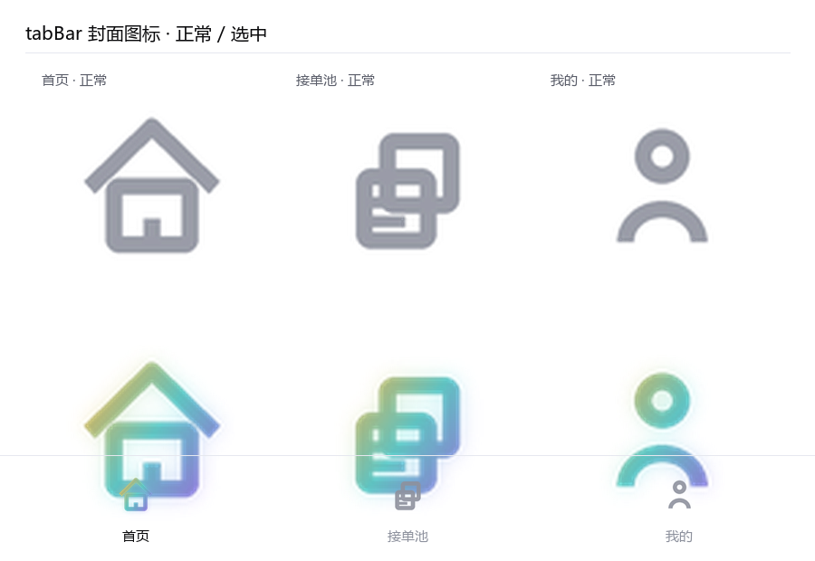
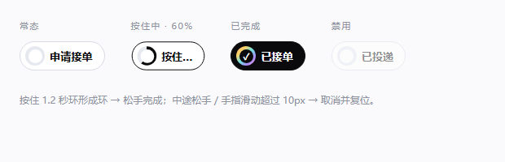
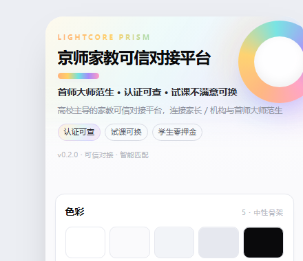

# 京师家教可信对接平台（微信小程序 MVP）

> 高校主导的家教可信对接平台：连接家长/机构与首师大师范生。
> 核心能力：**可靠度认证 + 智能匹配 + 风险过滤**。

- 技术栈：微信小程序原生（WXML + WXSS + JS）+ 微信云开发（云函数 / 云数据库 / 云存储）
- 当前阶段：**MVP 基础功能**，二期能力（支付担保、真实 OCR、真实视频评审、LLM 推荐理由、站内聊天）全部用 mock 或 `TODO` 占位
- 默认数据源：**本地 mock + Storage**（导入微信开发者工具即可完整演示，无需任何后端配置）

---

## 一、MVP 主链路

```
家长发布家教需求 → 系统风险过滤 → 师范生三重认证 → 智能匹配推荐 Top3 → 生成对接报告/避坑提示
```

| 环节 | 实现位置 | 说明 |
| --- | --- | --- |
| 发布需求 | `pages/demand-create` + `services/api.createDemand` | 表单校验 + 提交前风险检测 |
| 风险过滤 | `services/risk.js`（前端）+ `cloudfunctions/riskCheck`（服务端） | 15 词风险词库，输出 低/中/高，高风险必须二次确认才允许发布 |
| 三重认证 | `pages/tutor-verify` + `services/api.submitCertification` | 学籍 / 资质 / 能力三关，mock 审核，通过后生成认证徽章与唯一编号 |
| 智能匹配 | `services/match.js` + `cloudfunctions/matchTutors` | 规则打分（科目 40 + 年级 20 + 时间地点 15 + 价格 10 + 信用分 10 + 认证 5），输出 Top3 + 推荐理由 |
| 对接报告 | `pages/report-detail` + `services/api.generateReport` | 需求摘要 / Top3 / 推荐理由 / 认证信息 / 风险提示 / 下一步建议 / 免责声明，支持复制文本 |

---

## 二、项目目录结构

```
2026大挑京师家教/
├── project.config.json               # 微信开发者工具项目配置（miniprogramRoot / cloudfunctionRoot）
├── README.md
├── miniprogram/                      # 小程序前端根目录
│   ├── app.js                        # 入口：登录、角色恢复、全局工具
│   ├── app.json                      # 页面注册、tabBar、窗口样式
│   ├── app.wxss                      # 全局样式与设计令牌（CSS 变量）
│   ├── sitemap.json
│   ├── pages/
│   │   ├── index/                    # 首页与角色选择（tabBar）
│   │   ├── demand-create/            # 家长发布需求
│   │   ├── demand-list/              # 需求列表
│   │   ├── demand-detail/            # 需求详情（家长视角 / 师范生视角）
│   │   ├── match-result/             # 智能匹配结果 Top3
│   │   ├── report-detail/            # 对接报告 / 避坑提示
│   │   ├── tutor-verify/             # 师范生三重认证
│   │   ├── tutor-pool/               # 学生接单池（tabBar）
│   │   ├── tutor-detail/             # 师范生详情
│   │   └── profile/                  # 我的（tabBar）
│   ├── components/
│   │   ├── RiskAlert/                # 风险提示弹层（红/橙警示）
│   │   ├── CertBadge/                # 认证徽章（认证可查）
│   │   ├── TutorCard/                # 家教卡片（含匹配度与推荐理由）
│   │   └── DemandCard/               # 需求卡片（含风险标签）
│   ├── services/
│   │   ├── api.js                    # 统一接口层：一键切换 云函数 / mock
│   │   ├── phase2.js                 # 二期模块：打卡/小结/双向盲评/信用分/确认成单/接单池筛选
│   │   ├── risk.js                   # 风险词检测 + 双减政策合规检测
│   │   └── match.js                  # 匹配打分与推荐理由模板
│   ├── utils/
│   │   ├── constants.js              # 品牌、字典、风险词库、权重、免责声明、双减规则、互评标签
│   │   └── format.js                 # 格式化与脱敏工具
│   └── mock/
│       ├── tutors.js                 # 6 位师范生档案 + 认证记录
│       ├── demands.js                # 7 条家教需求（含中/高风险 + 已匹配订单 + 素质拓展示例）
│       ├── checkins.js               # 打卡记录（1 条已确认 + 1 条待家长确认）
│       └── reviews.js                # 评价（1 条家长单方已评 → 用于演示盲评揭晓）
├── cloudfunctions/                   # 微信云函数根目录
│   ├── login/                        # 获取 openid，创建/查询用户
│   ├── riskCheck/                    # 风险词检测 + 双减政策检测（读 risk_words，失败回退本地词库）
│   ├── submitDemand/                 # 写 demands + 双减硬拦 + 风险拦截 + 确认成单
│   ├── submitCertification/          # 写 certifications + mock 审核 + 重算认证等级
│   ├── submitCheckin/                # 二期新增：上课打卡 / 结束打卡+小结 / 家长确认
│   ├── submitReview/                 # 二期新增：双向盲评状态 / 提交评价 / 已揭晓列表 + 信用分结算
│   ├── matchTutors/                  # 打分匹配 Top3 + 写 matches（含接单池排序）
│   ├── generateReport/               # 聚合生成报告并写 reports
│   └── common/
│       ├── index.js                  # 通用 ok/fail/validate 与词库导出
│       ├── riskWords.js              # 权威风险词库 + 双减规则（各云函数内为同步副本）
│       └── package.json
├── database/                         # 云数据库集合初始化数据（JSON Lines，可直接导入）
│   ├── users.json
│   ├── tutors.json
│   ├── certifications.json
│   ├── demands.json
│   ├── matches.json
│   ├── reports.json
│   ├── checkins.json                 # 二期新增：打卡记录
│   ├── reviews.json                  # 二期新增：双向评价
│   ├── risk_words.json               # 含双减政策词条
│   └── README.md                     # 集合设计、字段表、导入步骤、索引建议、合规声明
└── tools/
    └── validate-project.js           # 工程自检脚本（JSON/页面齐全性/组件契约/事件与字段一致性）
```

---

## 三、快速开始（mock 模式，零配置）

1. 打开 **微信开发者工具** → `导入项目`。
2. 目录选择本项目根目录 `2026大挑京师家教`（**不要**选 `miniprogram` 子目录，`project.config.json` 已指定 `miniprogramRoot`）。
3. AppID 使用项目自带的 `wxb921d6701948eebb`（已写入 `project.config.json`）；若换成自己的 AppID 或点「测试号」，mock 流程同样可完整跑通。
4. 点击「编译」，即可开始演示（默认 `APP_INFO.useCloud = false`，全部数据走本地 Storage 模拟）。

> 首次运行会自动把 `miniprogram/mock/*` 的演示数据灌入 Storage，之后所有改动都保存在本地，重启小程序数据仍在。

---

## 四、演示脚本（验收路径）

### 路径 A：家长全链路

| 步骤 | 操作 | 预期结果 |
| --- | --- | --- |
| 1 | 首页点击「我是家长」 | 角色高亮 ✓，出现家长功能入口 |
| 2 | 点击「发布家教需求」 | 进入发布页，看到「发布前必读」提示 |
| 3 | 填写：科目=数学、学段=初中/年级=初三、频次=每周 2 次、时间段=周末上午、区域=海淀区、地点=…、方式=线下上门、预算 120-140 | 预算实时预览为「120-140元/小时」 |
| 4 | 在「特殊要求」里输入 `需要先交押金，并提供身份证复印件` | 内联风险提示条立刻变红，命中「押金」「交押金」「身份证」 |
| 5 | 点击「提交需求并开始匹配」 | 弹出 **RiskAlert**（高风险）：显示风险等级、命中词、每个词的避坑提示 |
| 6 | 点「我已知晓风险，仍要发布」 | 需求写入成功 → 自动跳转智能匹配结果页（高风险不确认则无法发布） |
| 7 | 匹配结果页 | 看到 Top3 师范生卡片：排名、匹配度分数、推荐理由、认证徽章、距离、课时费 |
| 8 | 点底部「生成对接报告」 | 跳转对接报告页：需求摘要 / Top3 / 推荐理由 / 认证信息 / 风险提示 / 下一步建议 / 免责声明 |
| 9 | 点「复制报告文本」 | 提示已复制，可粘贴到备忘录验证 |
| 10 | 「我的」→「我的需求」/「我的对接报告」 | 能看到刚发布的需求与生成的报告 |

> 想快速看「低风险」流程：特殊要求填写正常内容（如「函数与几何压轴题专项突破」），则不会弹出风险弹层，提交后直接进入匹配页。

### 路径 B：师范生全链路

| 步骤 | 操作 | 预期结果 |
| --- | --- | --- |
| 1 | 首页点击「我是师范生」 | 角色切换为师范生，出现认证与接单入口 |
| 2 | 点「完成三重认证」 | 进入三步认证页，顶部显示当前认证等级与进度 |
| 3 | 学籍认证：填学号 + 校园邮箱 → 提交 | 状态「审核中…」→ 约 1.2 秒后变「已通过（mock 模拟审核）」，展示脱敏学号/邮箱 |
| 4 | 资质认证：选证书类型 + 上传图片（本地）→ 提交 | 展示 mock OCR 识别字段 → 审核通过 |
| 5 | 能力认证：填试讲视频链接 + 多选教学能力标签 → 提交 | mock 规则评审通过，能力标签写入档案 |
| 6 | 三关通过后 | 顶部出现完整 **认证徽章**：姓名/学校/专业/年级/认证等级/唯一编号/能力标签 |
| 7 | 点「进入接单池」 | 切换到接单池 tab，看到按「匹配度+距离+价格+信用分」排序的订单列表 |
| 8 | 点某个订单的「申请接单」 | 提示「申请已提交，等待家长确认」，按钮变「已申请」 |
| 9 | 「我的」→ 我的认证 / 我的接单 | 看到三项认证状态、信用分、认证徽章、申请记录 |

> 想完整重走认证流程：认证页底部「重置认证（演示用）」→ 确认，清空认证记录后重新提交；或「我的」→「重置演示数据」恢复出厂 mock。

---

## 五、切换到微信云开发（正式模式）

### 1. 前置条件

- 必须使用**真实 AppID**（游客模式 `touristappid` 不支持云开发）；
- 微信开发者工具中已开通「云开发」并创建环境，记下 **环境 ID**。

### 2. 前端开关（一处切换）

编辑 `miniprogram/utils/constants.js`：

```js
const APP_INFO = {
  // ...
  useCloud: true,                    // ← 由 false 改为 true
  cloudEnv: 'your-env-id-xxxxxx'     // ← 填你自己的云开发环境 ID
};
```

云开发初始化已封装在 `miniprogram/services/api.js` 的 `ensureCloud()` 中（`wx.cloud.init({ env: APP_INFO.cloudEnv, traceUser: true })`，懒加载、只初始化一次），**无需**在 `app.js` 里重复初始化。

### 3. 创建集合并导入数据

在云开发控制台 → 数据库，依次新建集合并导入 `database/` 下同名 JSON 文件：

```
users / tutors / certifications / demands / matches / reports / risk_words
```

导入格式说明、字段表、权限与索引建议见 **[database/README.md](database/README.md)**。

### 4. 上传云函数

在开发者工具左侧资源管理器的 `cloudfunctions` 目录下，对每个云函数右键 → **上传并部署：云端安装依赖**：

```
login / riskCheck / submitDemand / submitCertification / matchTutors / generateReport
```

> `cloudfunctions/common` 不是云函数，不需要上传（它无法被跨目录 require，各云函数内已有同步副本，详见「注意事项」）。

### 5. 云函数与前端接口对照

| 前端调用（`services/api.js`） | 云函数 | 入参 | 返回 |
| --- | --- | --- | --- |
| `login({role})` | `login` | `{role}` | `{openid, user, tutorProfileId, parentId}` |
| `riskCheck(text,{remote:true})` | `riskCheck` | `{text}` | `{level, hits, tips, summary}` |
| `createDemand(form,{riskAcknowledged})` | `submitDemand` | `{form, riskAcknowledged}` | `{demand, risk}`（高风险未确认返回 `code:2`） |
| `updateDemandStatus(id,status)` | `submitDemand` | `{action:'updateStatus', demandId, status}` | 更新后的需求 |
| `submitCertification({...})` | `submitCertification` | `{tutorId, type, files, form}` | 认证记录 |
| `reviewCertification(id,decision)` | `submitCertification` | `{action:'review', certId, decision, reviewNote}` | `{certification, tutor}` |
| `matchTutors(demandId,{topN})` | `matchTutors` | `{demandId, topN}` | `{demand, list, matches}` |
| `getTutorPool({tutorId})` | `matchTutors` | `{action:'pool', tutorId}` | `{tutor, list}` |
| `generateReport(demandId)` | `generateReport` | `{demandId}` | 报告对象 |

统一返回结构：`{ code, data, message }`，`code === 0` 成功，`code === 1` 参数错误，`code === 2` 需用户二次确认，`code === -1` 服务端异常。

> 云函数模式下的**纯读接口**（需求列表/详情、师范生列表/详情、认证列表、报告列表）目前仍走本地 Storage，代码中标注了 `TODO(二期)`，对应云函数尚未实现。这样保证任何一处不完整都不会导致演示失败；切换模式后「发布需求 / 认证 / 匹配 / 报告」四条写链路已真实走云端。

---

## 六、切换 mock 数据 / 重置演示状态

| 目的 | 方式 |
| --- | --- |
| 全局切换数据源 | `miniprogram/utils/constants.js` → `APP_INFO.useCloud` |
| 恢复出厂演示数据 | 「我的」页 →「重置演示数据」，或任意页面控制台执行 `require('services/api.js').resetMockData()` |
| 只重置师范生认证 | 认证页底部「重置认证（演示用）」→ `api.resetCertifications(tutorId)` |
| 修改演示师范生 | `miniprogram/mock/tutors.js`（6 条档案 + 3 条认证记录） |
| 修改演示需求 | `miniprogram/mock/demands.js`（5 条，含 1 条中风险、1 条高风险示例） |
| 数据未生效 | Storage 里的旧数据优先：执行一次「重置演示数据」即可重新灌入 mock |

本地 Storage 的 key 统一在 `utils/constants.js` 的 `STORAGE_KEYS` 中定义（`js_tutors` / `js_demands` / `js_certifications` / `js_matches` / `js_reports` / `js_applications` …）。

---

## 七、核心规则说明

### 1. 风险过滤（`services/risk.js` + `cloudfunctions/riskCheck`）

- 词库共 15 条，`word / category / level / tip` 四要素，分两级：
  - `high`（典型诈骗特征）：交押金、押金、保证金、扣押证件、培训贷、贷款、日入过千、轻松月入过万、刷单、黑中介
  - `medium`（收费/资质敏感）：身份证、中介费、先交费、服装费、体检费
- 等级判定：任一命中 `high` → **高风险**；否则任一 `medium` → **中风险**；无命中 → 低风险。
- 处理策略：**高风险必须二次确认后才允许发布**（未确认时 `createDemand` 返回 `code:2`，不写库）；中/低风险在提交前弹出一次提示并展示避坑建议。
- 词库维护：`miniprogram/utils/constants.js` 的 `RISK_WORDS`、`cloudfunctions/common/riskWords.js`、以及 `riskCheck`/`submitDemand` 两个云函数目录内的 `riskWords.js` 副本 —— **四处内容必须一致**（二期计划改为统一读 `risk_words` 集合，前端本地缓存）。

### 2. 匹配打分（`services/match.js` + `cloudfunctions/matchTutors`）

| 维度 | 分值 | 规则摘要 |
| --- | --- | --- |
| 科目匹配 | 40 | 完全一致 40；「全科」导师 32；同学科门类（理科/文科）18；否则 0 |
| 年级学段 | 20 | 同年级 20；同学段 14；相邻学段 7；否则 0 |
| 时间地点 | 15 | 授课方式吻合 5 + 同区/线上 4 + 距离梯度 0~4 + 时间段交集 6 |
| 价格 | 10 | 报价 ≤ 预算 10；≤ 预算×1.2 给 6；超出给 2 |
| 信用分 | 10 | `creditScore / 100 × 10` |
| 认证完整度 | 5 | 三重认证 5；双重 3.5；学籍 2；未认证 0 |

- 输出 Top3，并把 `score / reasons / rank` 写入 `matches` 集合。
- 接单池排序（`rankPoolDemands`）：`匹配度×0.5 + 距离×0.2 + 价格×0.15 + 信用分×0.15`。
- 推荐理由当前由**模板**生成（`buildReasons`），已预留 `generateReasonsByLLM()` 接口，二期替换为 LLM 生成并保留模板兜底。
- **演示数据的一致性**：`database/matches.json` 与 `reports.json` 中的分数不是手写数字，而是按上述公式对 `demo_demand_001` 实算的结果 —— **Top3 为 `tutor_001 林嘉怡 99.2 分 / tutor_006 郑一诺 75.3 分 / tutor_004 赵沐阳 74 分`**。这样家长在匹配页点「重新匹配」得到的排名与导入的种子数据完全一致，演示不会自相矛盾（实算全表见 `database/README.md`）。
  > 二期把 `demo_demand_001` 的时段从「周末上午 + 工作日晚上」合规化为「仅工作日晚上」后，赵沐阳（周末为主）的时段分由 12.5 降到 6.5、总分 80→74，被郑一诺（75.3）反超。**这是规则正确执行的结果，不是数据错误**；若有截图或文档引用旧 Top3，需要同步更新。

### 3. 认证等级与徽章

| 等级 | 含义 | 触发条件 |
| --- | --- | --- |
| 0 | 未认证 | 无已通过认证 |
| 1 | 学籍已认证 | 学籍认证通过 |
| 2 | 双重认证 | 学籍 + 资质通过 |
| 3 | **三重认证** | 学籍 + 资质 + 能力全部通过，生成唯一编号 `JS-<年份>-<6位>` |

信用分同步重算：`基础 70 + 学籍 8 + 资质 8 + 能力 6`（上限 100）。

---

## 八、UI 与组件规范

- **主色**：教育蓝 `#1F4FBF`（深）/ `#2B6DE5`（亮）/ `#EAF1FF`（浅底）；**可信绿** `#17B26A`；风险用橙 `#F79009` / 红 `#F04438`。全部定义在 `app.wxss` 的 `page { --xxx }` CSS 变量中，组件内以 `var(--brand-primary, #1F4FBF)` 形式引用（自定义属性会继承进组件）。
- **风格**：干净、可信、卡片式；认证徽章显眼（绿盾 + 编号），风险提示用红/橙警示。
- **首页信任文案**：认证可查 · 试课不满意可换 · 学生零押金。
- **自定义组件**（`miniprogram/components/`，全部为原生实现）：
  - `CertBadge`：`level(0-3) / name / school / major / grade / badgeNo / tags / abilityTags / verifiedAt / size / showDetail / clickable`
  - `RiskAlert`：`visible / level / title / hits / tips / confirmText / cancelText / showCancel`，事件 `confirm` `close`
  - `TutorCard`：`tutor / rank / score / reasons / distanceKm / showApply / applyText / applied / showCertBadge`，事件 `tap` `apply`
  - `DemandCard`：`demand / showRisk / showStatus / score / reasons / showApply / applyText / applied / showMeta`，事件 `tap` `apply`
- **关于 Vant Weapp / TDesign**：本项目**刻意不引入**第三方组件库，原因是「导入微信开发者工具即可运行、无需构建 npm」，这是 MVP 验收（可演示、可截图）的最高优先级。若二期要接入 TDesign MiniProgram：

  ```bash
  cd miniprogram && npm init -y && npm i tdesign-miniprogram
  ```

  然后在开发者工具中执行「工具 → 构建 npm」，并在 `app.json` 增加 `"usingComponents": {}` 按需引入；由于本项目组件已按「属性 + 事件」契约封装，替换成本集中在 `components/` 四个文件内，页面无需改动。

---

## 九、合规与安全

1. **免责声明**：首页、需求详情、报告页、我的页均展示 —— 平台仅提供可信对接与能力认证，**非学历培训、非办学资质、非医疗建议**。
2. **不接真实支付**：不实现任何支付/担保/结算能力，报告中「资金担保结算」标注 `TODO(二期)`。
3. **未成年人保护**：未成年人线下上课需监护人知情，平台建议优先线上授课或校内认证场地（发布页、匹配页、报告页均有提示）。
4. **脱敏存储**：手机号 `138****8888`、学号 `1202****0918`、邮箱 `lin****@cnu.edu.cn`，脱敏函数集中在 `utils/format.js`，写入前即脱敏。
5. **不采集敏感信息**：开发阶段全部为 mock 数据，**不含真实身份证、真实学号、真实联系方式**；线上环境同样禁止采集身份证原件/照片。
6. **风险拦截**：押金、扣押证件、培训贷、刷单等关键词触发高风险强提示，未确认不允许发布。

---

## 十、二期 TODO 清单（代码中均已用 `TODO(二期)` 标注）

| 能力 | 现状 | 位置 |
| --- | --- | --- |
| 真实 OCR（教资证、普通话证） | mock `ocrResult` | `services/api.buildMockOcr`、`cloudfunctions/submitCertification` |
| 真实学籍库校验 | 邮箱域名/学号规则 mock 校验 | `cloudfunctions/submitCertification` |
| 真实视频评审 | 仅记录链接/本地路径 | `pages/tutor-verify`、`cloudfunctions/submitCertification` |
| LLM 生成推荐理由 | 模板 `buildReasons` | `services/match.generateReasonsByLLM`、`cloudfunctions/generateReport` |
| 语义匹配（向量召回） | 规则打分 | `services/match.scoreSubject/scoreGrade` |
| 支付与资金担保结算 | 不实现，仅提示 | `services/api.buildNextSteps`、报告页 |
| 站内聊天 / 消息通知 | 无，弹窗提示 | `pages/tutor-detail`、`applyDemand` |
| 报告导出 Word / Excel | 按钮禁用 + toast | `pages/report-detail` |
| 云存储（头像、证书、视频） | 仅本地临时路径 | `pages/tutor-verify` |
| 真实地理距离（geoNear） | mock `distanceKm` / 城区中心点估算 | `services/match.estimateDistance` |
| 云函数纯读接口分页 | 单次 100 条 | `cloudfunctions/matchTutors` 等 |
| 云数据库权限校验 | 未校验 OPENID 归属 | `cloudfunctions/submitDemand` |

---

## 十一、注意事项与常见问题

1. **tabBar 页面跳转**：`pages/index`、`pages/tutor-pool`、`pages/profile` 是 tabBar 页面，必须用 `wx.switchTab`，用 `wx.navigateTo` 会静默失败。
2. **云函数的 `require` 路径**：微信云函数上传时只打包自身目录，`require('../common/riskWords')` 在云端会报错。因此 `riskCheck`、`submitDemand` 目录内各有一份 `riskWords.js` 同步副本，**修改风险词库时请四处同时更新**（`utils/constants.js`、`common/riskWords.js`、两个副本）。
3. **AppID 与云开发**：`project.config.json` 中已写入本项目的正式 AppID（`wxb921d6701948eebb`）；改用别的 AppID 或游客模式（`touristappid`）时 **云开发不可用**，要跑云函数必须使用一个已开通云开发环境的真实 AppID。
4. **云数据库单次查询上限 100 条**：`matchTutors` 读取 tutors 时用了 `.limit(100)`，师范生规模变大后需改为分页（代码中已标 TODO）。
5. **日期字段**：mock 与 `database/*.json` 使用字符串时间（`"2026-01-08 19:24"`），云函数写库用 `db.serverDate()`；两者混用时前端统一按字符串/时间戳展示，`utils/format.js` 均已兼容。
6. **数据看起来没更新**：Storage 中的旧数据优先，执行「我的 → 重置演示数据」即可重新灌入 mock。
7. **不要提交真实个人信息**：`database/` 与 `miniprogram/mock/` 中的所有手机号、学号、邮箱均为脱敏假数据。
8. **`scope.userLocation` 的 desc 有 30 字上限（上传报 80058）**：`app.json` 中若声明了定位权限，`desc` 超过 30 字会导致**上传直接失败**，错误码 `80058`（`desc(...) of scope.userLocation exceeds 30`）。本项目 MVP 的距离全部是 mock（`tutor.distanceKm` + 城区中心点估算），代码里**从未调用** `wx.getLocation` / `wx.chooseLocation`，因此 `app.json` 中已**刻意不声明**该权限（最小权限原则，也避免审核追问）。二期接入真实定位时再补回，且文案必须 ≤30 字，例如：

   ```json
   "permission": {
     "scope.userLocation": { "desc": "用于计算与家教的距离，仅作匹配排序参考" }
   }
   ```

   同时二期还需要在 `app.json` 的 `requiredPrivateInfos` 中声明 `getLocation` / `chooseLocation`。
9. **上传前建议先跑自检**：`node tools/validate-project.js`，可提前发现 JSON 非法、组件未注册、事件未定义等问题，比在开发者工具里逐个报错更快。
10. **在 IDE 外部修改文件后，务必让 IDE 重新读取**：本项目常有"用编辑器/脚本直接改文件、IDE 里还开着工程"的场景。开发者工具的文件监听**可能漏掉外部改动**，此时它编译与上传用的仍是上一次的缓存产物（表现为：磁盘文件明明已改好，上传却报的是旧内容的问题，例如 `app.json` 的 `80058` 会一直复现）。处理办法：先在 IDE 里关闭对应文件的标签页（不保存）→ 按 `Ctrl+B` 重新编译 → 仍异常则「工具 → 清除缓存 → 清除全部缓存」并重启开发者工具。
11. **不要用「盘符根目录」或「桌面」当工程目录**：导入时若选错文件夹，开发者工具会在该目录写下 `project.config.json`（无 `miniprogramRoot`）。之后一旦误打开该目录为工程，上传会把整个目录树当代码包扫描。导入时请务必选中本项目根目录 `2026大挑京师家教`。

---

## 十二、工程自检脚本

项目自带两个零依赖脚本，改完代码后建议都跑一遍再交演示：

```bash
node tools/validate-project.js   # 静态结构自检（页面/组件/JSON/事件/字段/属性契约）
node tools/verify-flows.js       # 业务链路验收（49 项：双减/接单池/打卡/盲评/报告/一期回归）
```

`tools/verify-flows.js` 用最小 `wx` 桩 + 内存 Storage 真实驱动 `services/api.js`，覆盖：

| 分组 | 内容 |
| --- | --- |
| A | 双减规则 8 组用例 + 违规需求返回 `code 3` 且**不写库** |
| B | 前端 `risk.js` 与三份云函数词库副本的**文案与判定一致性** |
| C | 接单池三组筛选 + 状态计数（已匹配只含自己成单） |
| D | 确认成单 → 打卡（含幂等）→ 小结（含长度校验）→ 家长确认 |
| E | 双向盲评（含"未揭晓不泄露对方内容"）与信用分结算 |
| F | 一期回归：风险词 `code 2`、匹配 Top3、报告七段结构与试课建议 |

检查项（`validate-project.js`，全部通过时退出码为 0）：

1. 所有 `.json` 合法；`database/*.json` 按 **JSON Lines** 逐行解析，并校验每行都有唯一 `_id`；
2. `app.json` 注册的每个页面，`js / json / wxml / wxss` 四件套齐全；tabBar 页面已在 `pages` 中注册；
3. `usingComponents` 的路径真实存在，且被引用组件都声明了 `"component": true`；
4. WXML 里 `bind* / catch*` 绑定的处理函数都在对应 js 中定义；
5. WXML 里 `{{ }}` 引用的顶层字段都能在 js 中找到（用于发现字段拼写错误）；
6. 自定义标签（如 `<tutor-card>`）都在同目录 json 的 `usingComponents` 中注册，且传参属性都已在组件 `properties` 中声明；
7. 架构约束：页面/组件不得直接读写业务 Storage、不得直接调用 `wx.cloud`（提示为 warning）。

> 组件属性统一使用 **kebab-case**（`show-risk` / `apply-text` / `distance-km`），与组件内 camelCase 的 `properties` 自动对应，这也符合微信官方文档的写法。

---

## 十三、二期新增能力（双减合规 / 履约打卡 / 双向盲评）

### 1. 双减政策合规拦截（红线，硬拦不可放行）

判定规则（`services/risk.js` 与 `cloudfunctions/common/riskWords.js` 是**同一套实现**）：

- **规则 A**：学科类（语文 / 数学 / 英语 / 物理 / 化学 / 生物，或用户勾选"学科类"）× 休息日 / 法定节假日 / 寒暑假 → **阻断**
- **规则 B**：学龄前 / 幼小衔接 × 休息日 × 学科类（含全科） → **阻断**
- **文本兜底**：除时间段下拉值外，还会扫描需求文本里的「周末 / 周六 / 周日 / 节假日 / 寒暑假 / 假期 / 小长假」，防止用"特殊要求"绕过下拉框

| 场景 | 结果 |
| --- | --- |
| 数学 + 周末上午 | ❌ 阻断（`code 3`） |
| 数学 + 工作日晚上 | ✅ 允许 |
| 美术 + 周末上午 | ✅ 允许（素质拓展不受限） |
| 幼小衔接 + 全科 + 周末 | ❌ 阻断（规则 B） |
| 下拉选"工作日"但文本写"周六周日" | ❌ 阻断（文本兜底） |

阻断提示（与后端逐字一致）：**根据双减政策，严禁在休息日及节假日开展学科类培训，请勿发布违规需求**

与一期风险词拦截的**本质区别**：

| | 风险词命中 | 双减命中 |
| --- | --- | --- |
| 返回码 | `code 2` | **`code 3`** |
| 处理 | 强提示 → 用户二次确认后可发布 | **禁止发布**，必须修改时段或改为素质拓展 |
| 界面 | `RiskAlert` 含"继续提交" | 阻断弹窗，**没有继续提交按钮** |

### 2. 平台定位声明（所有页面底部）

`components/PlatformNotice` 通过 `app.json` 的**全局 `usingComponents`** 注册，页面只需一行 `<platform-notice />`：

> 本平台仅为个人零星家教信息撮合，非培训机构，不提供固定办学场所

点击可展开完整声明与三条边界说明（非培训机构 / 非办学场所 / 不组织学科类培训）。

### 3. 学生接单池（三组筛选 + 状态 Tabs）

- **科目 Tab**：全部 / 语文 / 数学 / 英语 / 物理 / 化学 / **素质拓展**（聚合所有非学科类）
- **授课方式 Tab**：全部 / 线上 / 线下 / 校内场地
- **匹配度开关**：只看匹配度 ≥ 70
- **状态 Tabs**：招募中（可投递）/ 匹配中（面试·试课中）/ 已匹配（已成单），带数量角标；"已匹配"只显示**我自己成单**的订单
- **排序说明**（灰字，来自 `POOL_SORT_NOTE` 常量，不写死数字）：排序规则：匹配度50% + 距离20% + 价格15% + 信用分15%
- **卡片**：右上角状态角标 + 五项标签（每周频次 / 时间段 / 授课方式 / 区域 / 薪资）

### 4. 履约打卡与课后小结

状态机：`checked_in`（已打卡，进行中）→ `finished`（已结束，待家长确认）→ `confirmed`（家长已确认）

- 仅 `demand.status === 'matched'` 且是该单成单师范生才可打卡（`api.canCheckin`）
- 打卡记录**开始时间 + mock 定位**（不采集真实位置，也不申请 `scope.userLocation`，与隐私声明一致）
- 结束打卡强制填写**授课小结 10~500 字**，家长端可见并确认
- 防重复：同一订单同时只允许一条进行中的打卡（重复点击幂等返回）
- 真实到课校验（蓝牙信标 / 地理围栏）为 `TODO(二期+)`

### 5. 双向盲评与信用分

- 单方提交 → 对方只看得到"已评价"，**看不到内容**；双方都提交 → 一起揭晓（`revealed`）
- 标签：家长评老师（准时 / 专业 / 耐心 / 提分帮助 / 沟通顺畅）；老师评家长（尊重老师 / 付款及时 / 环境安全 / 诉求合理）
- 评价**不可修改**（提交即锁定），防止"看完对方评价再改"
- 信用分（`CREDIT_RULES`）：5★ +3 / 4★ +1.5 / 3★ 0 / 2★ -2 / 1★ -4；≥4★ 时每命中 1 个正向标签额外 +0.5（最多 3 个）；夹取到 `[60, 100]`
- 家长也有信用分（`users.creditScore`，默认 80），被老师评价后更新

### 6. 对接报告新增内容

- **试课建议**独立成段：`试课建议：建议先通过线上或在校内认证场地进行首次试课，需监护人知情。`
- **平台性质声明**段落
- 「复制报告文本」同步包含上述两段（`buildReportText` 已扩展到七段结构）

### 7. 数据模型（MVP 取舍）

**一个需求 = 一个订单**：`checkins.orderId` / `reviews.orderId` 直接复用 `demandId`。二期若支持一需求多订单，再引入独立 `orders` 集合，`orderId` 改指向 `orders._id`（代码中已用 `orderId` 字段而非 `demandId` 命名，便于平滑迁移）。

### 8. 二期演示脚本

| 步骤 | 操作 | 预期结果 |
| --- | --- | --- |
| 1 | 家长 → 发布需求：勾选**学科类**、科目数学、时间选**周末上午** | 表单顶部出现红色政策阻断条，提交按钮变灰「请先修改为合规时段」 |
| 2 | 仍然点提交 | 弹「触发双减政策红线」+ 证据链（学科类科目 / 休息日时段），**没有继续提交按钮** |
| 3 | 把时间改成**工作日晚上**再提交 | 发布成功 → 自动跳匹配 Top3 |
| 4 | 改为**美术 + 周末上午** | 允许发布（素质拓展不受周末限制） |
| 5 | 需求详情（匹配中）→ 对某位师范生点「确认成单」 | 状态变「已匹配」，出现打卡 / 评价入口 |
| 6 | 师范生视角 → 上课打卡 → 结束并填写小结 | 生成记录，状态「待家长确认」 |
| 7 | 家长视角 → 打卡记录 → 确认本次履约 | 状态「家长已确认」 |
| 8 | 双方各提交评价 | 单方提交时对方内容隐藏；双方提交后同时揭晓并提示信用分变化 |
| 9 | 接单池 | 三组筛选 + 三个状态 Tabs 角标 + 排序说明灰字 + 卡片右上角状态角标 |

### 9. 关于 TDesign / Vant 组件库（技术栈要求的处理说明）

二期技术栈写了"TDesign MiniProgram 或 Vant Weapp"，本项目**仍未引入**，理由与代价如下：

- 两者都必须 `npm install` + 开发者工具「构建 npm」才能使用，属于**新增一个失败点**；而本项目已经历两次因配置导致的**上传失败**（`80058` 隐私 desc 超长、IDE 编译缓存），"导入即可运行、可上传"的优先级更高。
- 现有自研组件已覆盖同等能力，且属性契约由 `tools/validate-project.js` 自动校验，样式统一走 `app.wxss` 的 CSS 变量。
- 若要切换（答辩现场约 3 分钟可完成）：
  1. `cd miniprogram && npm init -y && npm i tdesign-miniprogram`
  2. 开发者工具 → 工具 → **构建 npm**
  3. `app.json` 增加 `"usingComponents": {}` 按需注册，例如 `"t-button": "tdesign-miniprogram/button/button"`
- 能力对应关系：Tabs→`t-tabs`、Tag→`t-tag`、Switch→`t-switch`、Popup→`t-popup`、Rate→`t-rate`、Textarea→`t-textarea`、Steps→`t-steps`、Badge→`t-badge`。页面已按「属性 + 事件」封装，替换集中在 `components/` 内，页面改动很小。

### 10. 云开发模式的边界（二期，重要）

切到 `APP_INFO.useCloud = true` 时，**二期新增能力尚未全部接线**。`services/phase2.js` 末尾有一段显式保护：云模式下二期接口统一返回明确提示，**宁可报错也不拿本地数据冒充云端数据**（否则会出现"云端需求 + 本地打卡"的静默错乱，比报错难查得多）。

| 能力 | 云模式现状 |
| --- | --- |
| 双减前端预检（发布页即时阻断条） | ✅ 可用（纯前端规则） |
| `submitDemand` 的服务端双减硬拦 | ✅ 已实现，命中返回 `code 3` |
| 确认成单 / 打卡 / 小结 / 盲评 / 信用分 / 接单池筛选 | ⚠️ 云函数**已写好**（`submitDemand action:accept`、`submitCheckin`、`submitReview`、`matchTutors action:pool`），但 `services/api.js` 的云分支尚未接线，调用会返回明确提示 |

接线入参（已固定，直接可用）：

- 打卡：`submitCheckin` + `{ action: 'start' | 'finish' | 'confirm', ... }`
- 评价：`submitReview` + `{ action: 'state' | 'submit' | 'list', ... }`
- 成单：`submitDemand` + `{ action: 'accept', demandId, tutorId }`
- 接单池：`matchTutors` + `{ action: 'pool', tutorId, subject, teachMode, status, minMatch }`

**词库不对称（有意设计）**：云端 `RISK_WORDS` 共 **21 条**（15 条欺诈类 + 6 条双减类），前端 `constants.RISK_WORDS` 只保留 15 条欺诈类。前端负责即时提示、服务端做最终裁决且更严；代价是云模式下可能出现"前端没提示、服务端返回 `code 2/3`"，但两条分支都有对应的确认/阻断处理，不会崩溃。若要让前后端严格同词库，把 6 条双减词同步进 `constants.RISK_WORDS` 即可。

---

## 十四、隐私与授权声明（微信「用户隐私保护指引」）

### 1. 实际调用的隐私接口（扫描确认，可复现）

| 接口 | 位置 | 触发场景 |
| --- | --- | --- |
| `wx.setClipboardData` | `components/CertBadge`、`pages/demand-detail`、`pages/report-detail`、`pages/tutor-verify` | 复制认证编号 / 需求编号 / 对接报告文本 |
| `wx.chooseMedia`（`mediaType: image \| video`，`sourceType: album + camera`） | `pages/tutor-verify` | 上传资质证书图片、试讲视频 |
| `wx.chooseImage` / `wx.chooseVideo`（低版本兜底） | `pages/tutor-verify` | 同上 |

**未调用**（因此无需声明）：`wx.getLocation` / `wx.chooseLocation`、`wx.getUserProfile` / `wx.getUserInfo`、`wx.getPhoneNumber`、`wx.getClipboardData`（读取剪贴板）、`wx.saveImageToPhotosAlbum`、麦克风、通讯录、蓝牙、订阅消息等。

### 2. 小程序管理后台需要填写的「信息类型 / 用途」

路径：**小程序管理后台 → 设置 → 服务内容声明 → 用户隐私保护指引 → 修改**

| 信息类型 | 用途（可直接粘贴） |
| --- | --- |
| 剪切板 | 用于把对接报告、认证编号复制到剪贴板，方便您保存或转发 |
| 你选中的照片或视频信息 | 用于上传教师资格证等认证材料及试讲视频，用于资质与能力审核 |
| 摄像头 | 用于现场拍摄认证材料照片或试讲视频 |

> 用途必须具体、真实，写"为了提供更好的服务"一类空话会被驳回。**本项目已确认保留「现场拍照 / 录像」入口**（认证材料多为纸质证书，需要现场拍摄），因此后台三项都要声明；若后续想减少声明项，把 `pages/tutor-verify` 中 `chooseMedia` / `chooseImage` / `chooseVideo` 的 `sourceType` 改为 `['album']`（仅相册选择）即可同时去掉「摄像头」声明。

**指引模板里其余空格的建议写法**（原则：填下去的每一句，产品里都必须真的做得到）：

| 空格 | 建议填写 | 依据 |
| --- | --- | --- |
| 变更用途时的再次告知方式 | `小程序内弹窗` | 项目内只有弹窗这一种显著告知手段（无推送 / 短信能力）；且重新调用隐私接口时微信会再次弹出授权窗，天然满足「再次征得明示同意」 |
| 撤回授权 / 删除信息的方式 | `小程序内「我的 → 隐私与授权 → 清除本地全部数据」，或在微信「小程序右上角 … → 设置」中关闭授权` | 该入口已实现（见下方第 3 节） |
| 投诉 / 联系渠道 | 团队邮箱或指导老师联系方式（**必须真实可达**，不要写示例邮箱） | 微信会核对，用户申诉时要用 |
| 信息存储期限 | `仅在您使用本平台期间保存于您的设备本地；您可随时自行清除` | MVP 阶段不上传服务器，数据只存本地 Storage |
| 存储地域 / 是否出境 | 中华人民共和国境内，不出境 | 项目未使用任何境外服务 |
| 第三方共享 | 不向任何第三方共享、转让、公开披露 | 项目内无第三方 SDK、无广告、无统计埋点 |
| 未成年人条款 | `若您为未成年人，请在监护人陪同下阅读本指引；平台涉及未成年学员的，线下上课需监护人全程知情` | 平台学员可能是未成年人，属必须声明项 |

### 3. 生效机制与代码侧行为

- **产品内的「撤回授权 / 删除信息」入口已实现**：`pages/profile` 底部「隐私与授权」卡片列出已声明的信息类型与用途，并提供「清除本地全部数据」（调用 `api.clearLocalData()`，清除需求 / 匹配 / 报告 / 认证 / 接单申请与身份偏好后恢复出厂演示数据）与「如何管理微信授权」（引导到微信「… → 设置」）。指引里写的那句话与这里一一对应。
- 指引**审核通过后生效**；基础库 `2.32.3+` 会在调用上述接口前由微信自动弹出官方授权弹窗，**代码无需改动**。
- 用户**拒绝授权**时：`chooseMedia` 在本项目中会 `resolve(null)` 静默返回（不打断填表流程）；4 处 `setClipboardData` 均带 `fail` 提示「复制失败，请确认已同意隐私授权」，不会出现"点了没反应"。
- 调试"未同意"场景：临时在 `app.json` 中加 `"__usePrivacyCheck__": true`，**发布前务必删除**。
- 隐私接口失败不应导致崩溃：所有调用点都做了 `fail` 兜底与静默降级（这是 MVP 可演示性的前提）。

### 4. 二期上云后必须补充的声明

一旦把手机号、学号、校园邮箱、证书图片、试讲视频上传到云数据库 / 云存储，必须如实**增加**信息类型：手机号、学历学籍信息、证件信息、相册（图片 / 视频）等，并在指引正文说明存储期限与删除方式，同时提供注销入口。MVP 阶段所有数据仅存本地 Storage 且已脱敏，不上传服务器。

---

## 十五、版本

- 版本：`0.2.0`（二期：双减合规 + 履约打卡 + 双向盲评）
- 数据源：默认本地 mock + Storage（`APP_INFO.useCloud = false`）
- 建议基础库：`3.5.5`（`project.config.json` 已配置），云开发需基础库 `2.2.3+`，全局自定义组件需 `2.11.1+`

---

## 十六、UI 主题：LIGHTCORE PRISM（浅色 · 虹彩）

小程序视觉为「黑白灰打底 + 虹彩点缀」的浅色设计系统，令牌与规则集中在 `miniprogram/app.wxss`。

### 1. 三条硬规则（新增页面必须遵守）

1. **颜色只用令牌**，禁止写死 hex；语义色（成功/警示/危险）仅用于状态。
2. **彩色只出现在"光"上**：渐变条、光环、进度、图表、徽章描边——不做大面积色块。
3. **层级靠边框 + 阴影 + 留白**表达，不靠加深背景色。

### 2. 色板

| 用途 | 令牌 | 值 |
| --- | --- | --- |
| 卡片 | `--paper` | `#FFFFFF` |
| 页面底 | `--snow` | `#FAFAFC` |
| 分区 | `--slate` | `#F2F4F8` |
| 描边 | `--line` | `#E6E8EF` |
| 文字 | `--ink` | `#0A0A0C` |
| 虹彩（唯一彩色） | `--spec-o/y/c/v/p` | `#FFB27A` `#FFD166` `#6FE3E1` `#A78BFA` `#FF9EC4` |

### 3. tabBar 封面图标

三枚 81×81 PNG，位于 `miniprogram/assets/tab/`：

| 页面 | 未选中 | 选中（虹彩渐变 + 柔光） |
| --- | --- | --- |
| 首页 | `home.png` | `home-on.png` |
| 接单池 | `pool.png` | `pool-on.png` |
| 我的 | `me.png` | `me-on.png` |



生成脚本：`python miniprogram/tools/build-tab-icons.py`（Python + Pillow，4 倍绘制后 LANCZOS 缩小）。

### 4. 长按环形确认按钮（接单）

接单是不可撤销动作，单击误触代价高，因此 `components/HoldButton` 采用**长按确认**：

- 按住 → 左侧环形进度条 0→100%（默认 1.2s）；
- 环形成满 → 松手视为确认，按钮转为墨色「✓ 已接单」；
- 中途松手 / 手指滑动超过 10px / 触发 `touchcancel` → 立即取消并复位，并提示"请长按 1.2 秒"。



已接入：接单池的 `DemandCard`、匹配结果页的 `TutorCard`。

**防抖动**（三个真实的抖动源，改动时请勿回退）：

1. 按钮**宽度固定 208rpx** —— 文案在「申请接单 / 按住… / 已接单」间切换，宽度自适应会把整行撑动（实测三态宽度均为 104px）；
2. **不用 `transform: scale()`** —— 哪怕 0.985 的缩放，配合列表重绘也会被感知为"抖"；
3. **环形进度不加 `transition`** —— `conic-gradient` 不可插值，过渡会让环每帧闪烁。

**取消接单**：已投递后按钮左侧出现「取消接单」。二次确认后调用 `api.cancelApplication()`：撤回投递、需求 `applyCount` 减一、家长端不再可见，之后可重新投递。**已成单的订单禁止撤回**（返回 `code 3`），避免履约中丢失订单关系。

| 参数 | 说明 |
| --- | --- |
| `label` / `doneLabel` | 常态 / 完成态文案 |
| `duration` | 按住时长（毫秒），默认 1200 |
| `disabled` / `done` | 禁用、已完成（由父组件回填） |
| `bind:confirm` | 环形成满时触发 |### 5. 签名元素

- `.prism-bar` 棱镜渐变条（5 段光谱）
- `.prism-ring` 折射光环（conic-gradient + 白色内圆，首页主视觉）
- `.btn-prism` 虹彩描边按钮（双背景 border-box 实现，兼容低版本 WebView）
- `.meter` 虹彩进度条 / `.bars` 渐变数据柱 / `.donut` 环形图 / `.switch` 开关

### 6. 预览与验收

小程序 UI 无法在 CI 里直接截图，因此提供等价预览工具：

```bash
cd miniprogram
node tools/make-preview.js     # 把 WXSS 转成浏览器可渲染的等价 CSS + 预览页
# 打开 miniprogram/.preview/mp-preview.html
```

> 预览工具把 `rpx` 按 750→375 折算成 `px`、把 `page` 选择器映射为包裹层，
> 布局与颜色与真机高度一致，可在提交前发现塌陷/重叠/挤压。



---

## 十七、三期迭代：角色治理 · 学生标签 · 沟通撮合

### 1. 角色越权修复（单一事实来源）

一期 `globalData` 只有 `role` 一个字段，页面各自从 storage 读，导致「首页切成家长、接单池仍按学生渲染」。

三期的做法：

| 位置 | 变化 |
| --- | --- |
| `app.globalData.currentRole` | 唯一事实来源；`role` 保留为兼容别名，两者始终同步 |
| `app.setRole()` | 更新 globalData → 落盘 → **通知订阅者**（不再有页面绕过它写缓存） |
| `app.guardRole(required, opts)` | 越权统一拦截：toast 提示 + 900ms 后自动 `switchTab` 回首页 |
| `pages/tutor-pool` | `onShow` 过闸门，非师范生**不加载数据、不渲染列表**，只显示无权限占位 |

> 微信不允许动态移除单个 TabBar 项，所以「隐藏入口」用守卫拦截实现，而不是改 tabBar。

### 2. 学生标签与灵活岗位

| 集合 | 新增字段 |
| --- | --- |
| `tutors` | `preferences`（接单偏好）、`personality`（性格特点） |
| `demands` | `teachType`、`expectedPersonality`、`status`、`studentConfirmed`、`parentConfirmed` |

选项常量集中在 `utils/constants.js`：`TEACH_TYPES` / `TUTOR_PREFERENCES` / `PERSONALITY_TAGS` / `EXPECTED_PERSONALITY`。
两边值域**刻意一致**，匹配算法直接做集合交集。

编辑入口：档案页「我的接单标签」（学生端）、发布页「授课类型 + 对老师性格的期望」（家长端）。

### 3. 匹配权重调整

```
科目 36 + 年级 18 + 时间地点 12 + 价格 9 + 信用分 10 + 认证 5 + 偏好与性格 10 = 100
```

偏好维度内部再拆：授课类型 6 分 + 性格期望 4 分。命中时推荐理由会写出来，例如
「该老师标签包含耐心细致，符合您的期望，且支持长期稳定授课。」

### 4. 沟通撮合状态机

```
recruiting（招募中）
   │  学生长按 2 秒报名 signupByHold()
   ▼
communicating（沟通中） ── 双方在 ChatPanel 自由发消息
   │  学生【确认接单】+ 家长【同意雇佣】
   ▼
matched（已匹配）
```

- **单向确认不成单**：任一方单独确认只写一条系统消息，状态仍是 `communicating`；
- 双向齐备才由 `settleIfBothConfirmed()` 置 `matched`，并写入系统消息「双方已达成共识，正式匹配成功！」；
- 幂等：重复长按报名不会重复建会话、不会重复发开场白。

### 5. 长按 2 秒怎么实现

微信原生 `bindlongpress` 阈值固定约 350ms 且不可配置，所以：

- `bindtouchstart` 起一个 50ms 定时器累计时长，满 **2000ms** 才报名；
- `bindtouchend / bindtouchcancel` 未满则复位并提示；
- `bindlongpress` 仍绑定，用于原生判定成立时给一次触感反馈。

### 6. 新增文件

`components/ChatPanel/` —— 沟通面板（双方共用，按 role 切换气泡方向与确认按钮）
`services/phase2.js` 新增 —— `signupByHold` / `getChatThread` / `sendChatMessage` /
`confirmByStudent` / `confirmByParent` / `getDemandChats` / `updateTutorTags` / `getTutorTags`

### 7. 验收

`node tools/verify-flows.js` → **76/76**（三期新增 19 项，含单向确认不成单、双向确认成单、幂等、非法标签过滤）
