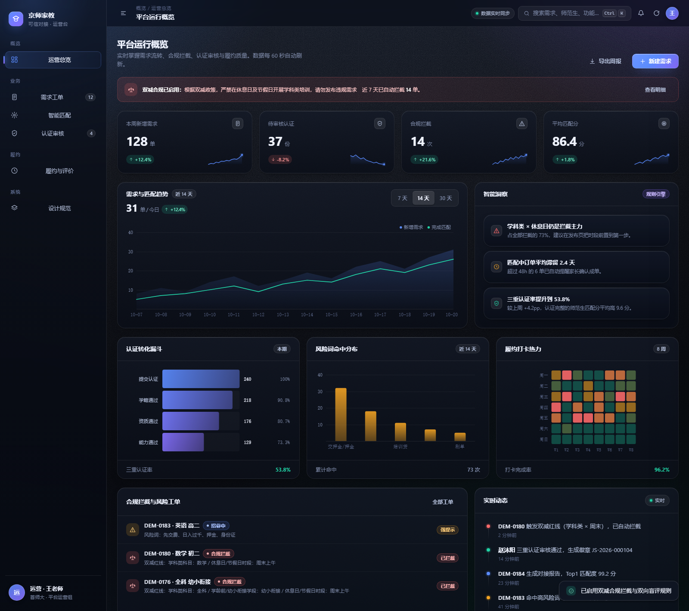
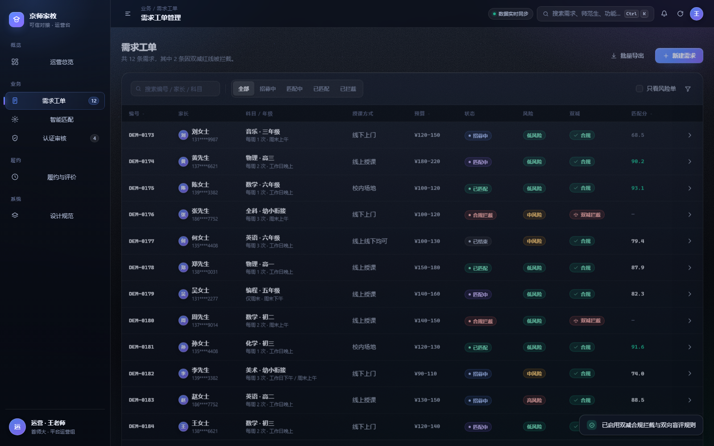
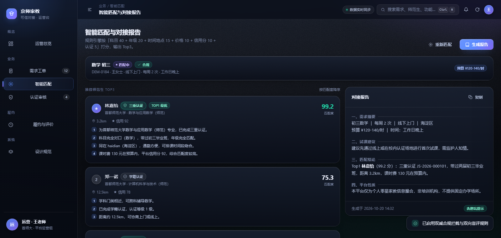
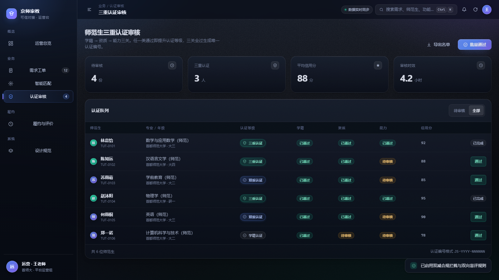

# 京师家教 · 可信对接运营控制台（Web）

> 深色科技风的产品级后台界面 —— **不是营销落地页**，而是给运营/审核人员日常使用的工具。
> 与微信小程序共用同一套业务模型（需求工单 / 双减合规 / 三重认证 / 智能匹配 / 履约评价）。

---

## 一、如何打开

**方式 A（最简单，零依赖）**：直接双击 `index.html`。
本项目没有打包步骤、没有 `import`、没有 `fetch` 请求，`file://` 协议下可完整运行。

**方式 B（推荐，便于调试）**：

```bash
cd web-console
python -m http.server 8080
# 打开 http://127.0.0.1:8080
```

> 唯一的可选外部依赖是 CDN 上的 Three.js。**加载失败不会白屏**：背景会自动降级为自研 Canvas2D 粒子场。

---

## 二、目录结构

```
web-console/
├── index.html              # 应用外壳（侧栏/顶栏/内容区/浮层）
├── css/
│   ├── tokens.css          # 设计令牌：颜色/间距/圆角/动效曲线（唯一事实来源）
│   ├── base.css            # 重置、排版、四层氛围背景、滚动条、可访问性
│   ├── layout.css          # 应用栅格：侧栏 / 顶栏 / 内容区 / 12 列网格
│   ├── components.css      # 组件系统（卡片/KPI/按钮/表单/徽章/表格/抽屉/吐司…）
│   ├── views.css           # 各页面特有版式（看板/文档/评价卡/空态）
│   └── anim.css            # 动效层：滚动渐入、错峰、水波、闪烁、盲评锁
└── js/
    ├── data.js             # 演示数据（脱敏假数据，字段与小程序 mock 对齐）
    ├── icons.js            # 内联 SVG 图标集（24×24、currentColor）
    ├── charts.js           # Canvas 图表引擎（折线/面积/柱/环/迷你线/热力/漏斗）
    ├── components.js       # 组件工厂（纯函数返回 HTML，禁止页面手写结构）
    ├── views.js            # 六个视图模板 + 图表挂载 + 抽屉内容
    ├── three-bg.js         # 3D 氛围背景（Three.js 粒子/线框几何，含 2D 降级）
    └── app.js              # 控制器：路由/导航/动效编排/抽屉/吐司/命令面板/表格
```

---

## 三、四个层次的实现

### 1. CSS 视觉

| 要求 | 实现 |
| --- | --- |
| 毛玻璃 | `.card` / `.sidebar` / `.topbar` 统一 `backdrop-filter: blur(18px) saturate(130%)` + 半透明渐变底 |
| 柔阴影 | 三级阴影令牌 `--shadow-1/2/3`，低对比多层，避免"硬描边"廉价感 |
| 渐变网格 | `.atmos__mesh` 四段 radial-gradient 叠加，32s 极慢漂移 |
| 颗粒纹理 | 内联 SVG `feTurbulence` 噪声 + `mix-blend-mode: overlay`，零额外请求 |
| 细边框 | `--stroke-1/2/3` 三档 hairline；卡片额外叠加 `inset 0 1px 0` 顶部高光 |
| 分层布局 | 背景四层（网格/细线/粒子/渐晕）+ 内容三层（玻璃面/浮层/吐司），`z-index` 语义化变量 |

### 2. 交互动效

- **微交互**：按钮 `active` 缩放到 0.972 + 点击水波；导航项 hover 提亮；`.card--spot` 跟随光标的柔和光斑；表格行左侧扫光。
- **滚动渐入**：`IntersectionObserver` 驱动 `.reveal` / `.stagger`，卡片组按 55ms 递增错峰。
- **弹性动画**：折叠侧栏、抽屉、命令面板均使用 `--ease-spring`（`cubic-bezier(.22,1.22,.36,1)`）。
- **平滑过渡**：视图切换 420ms 淡入上移；数字滚动 760ms `easeOutCubic`。
- **控件状态反馈**：按钮六态（default / hover / active / focus-visible / disabled / loading）、开关按压拉长、复选框弹入、分段控件滑块。

### 3. 3D 氛围

- **粒子场**：800~1400 点（按面积自适应），蓝→紫插值，近大远小，整体透明度 0.25~0.45。
- **漂浮几何体**：3~4 个线框几何体（Icosahedron / Octahedron / Torus），偏四角分布，慢速自转。
- **视差**：鼠标位置归一化后阻尼跟随，位移幅度 ≤ 视口 6%。
- **不抢焦点**：额外叠加 `.atmos__vignette` 顶部渐晕；`prefers-reduced-motion` 下只渲染一帧静态图。

### 4. 组件系统

- 令牌 → 组件 → 视图三层单向依赖；视图**不允许**写行内样式覆盖组件。
- 数据看板布局：KPI 行（4 列）+ 主图/洞察双栏 + 三卡并排 + 列表/动态双栏。
- 完整控件状态在「设计规范」页可视检查（色板、按钮六态、徽章、认证等级）。

---

## 四、页面与产品逻辑

| 页面 | 核心逻辑 |
| --- | --- |
| 运营总览 | KPI + 需求/匹配趋势 + 认证漏斗 + 风险词分布 + 履约热力 + 合规拦截工单 + 实时动态 |
| 需求工单 | 搜索 / 状态分段 / 只看风险 / 按编号·预算·匹配分排序 / 行点击开抽屉（含双减校验证据） |
| 智能匹配 | Top3 卡片（匹配分、距离、信用分、逐条理由）+ 报告预览 + 一键复制（含试课建议与平台性质声明） |
| 认证审核 | 三重认证队列，学籍/资质/能力三列状态，抽屉内脱敏信息，通过后重算等级 |
| 履约与评价 | 打卡记录（mock 定位）+ 家长确认 + 双向盲评（未揭晓时锁定并显示 🔒） |
| 设计规范 | 令牌与控件的可视化，供团队对齐与验收 |

**与小程序一致的三条硬规则**：
1. 学科类 × 周末/节假日/寒暑假 → `code 3` 硬拦截，**不可通过确认发布**；
2. 平台性质声明常驻：`本平台仅为个人零星家教信息撮合，非培训机构，不提供固定办学场所`；
3. 双向盲评：双方都提交后才互相可见，信用分按 `5★+3 / 4★+1.5 / 1★-4` 结算。

---

## 五、快捷键与无障碍

| 操作 | 快捷键 |
| --- | --- |
| 打开命令面板（可搜需求/学生/页面） | `Ctrl K` / `⌘ K` |
| 面板内移动 / 打开 | `↑` `↓` / `Enter` |
| 关闭面板或抽屉 | `Esc` |

- 所有图标按钮均有 `aria-label`；抽屉/面板有 `role="dialog"` + `aria-modal`。
- 焦点环只在键盘操作时出现（`:focus-visible`），鼠标点击不显示。
- 命中区域最小 32px；数字统一 `font-variant-numeric: tabular-nums`。
- `prefers-reduced-motion: reduce` 时关闭全部动画与 3D 渲染。

---

## 六、界面截图

| 页面 | 预览 |
| --- | --- |
| 运营总览（KPI + 趋势 + 漏斗 + 风险分布 + 打卡热力） |  |
| 需求工单（搜索 / 状态分段 / 风险与双减标识 / 行点击抽屉） |  |
| 智能匹配（Top3 理由卡 + 对接报告） |  |
| 三重认证审核（等级徽章 + 三关状态 + 一键通过） |  |

> 截图由 `tools/make-preview.js` 生成的静态预览页渲染而来（`.preview/` 已加入 `.gitignore`）。
> 预览页会注入 `window.__STATIC_RENDER__ = true`，关闭数字滚动与图表入场动画，直接呈现终态——
> 这样自动化截图不会因为无头浏览器的虚拟时间被 `requestAnimationFrame` 卡住而停在动画第一帧。

---

## 七、已知边界（不假装完成）

1. **全部为 mock 数据**，`js/data.js` 是唯一数据源；接真实后端只需把 `DATA` 换成接口返回，视图层不用改。
2. 3D 背景为氛围装饰，**不承载业务信息**；Three.js 走 CDN，离线时降级为 Canvas2D。
3. 「新建需求 / 导出 / 批量通过」等按钮为演示态，仅给出吐司反馈，**未接真实写接口**。
4. 未做登录鉴权与权限区分（真实环境应加路由守卫与角色权限）。
5. 图表为自研 Canvas 实现，未做大数据量分页/采样（当前数据量级足够）。
